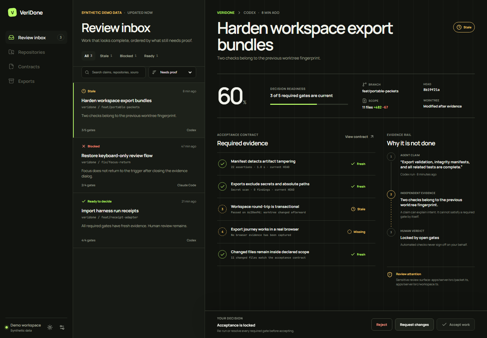

# VeriDone

> Don't trust “done.” Verify it.

[](https://github.com/fushanbobfan/veridone/actions/workflows/ci.yml)
[](https://github.com/fushanbobfan/veridone/actions/workflows/browser.yml)
[](https://github.com/fushanbobfan/veridone/actions/workflows/codeql.yml)
[](https://fushanbobfan.github.io/veridone/)

VeriDone is a local-first acceptance desk for AI-assisted software work. It turns agent claims, the exact Git worktree, operator-approved checks, and human decisions into a reproducible acceptance record.

**[Explore the synthetic public demo](https://fushanbobfan.github.io/veridone/)** — no account, backend, repository access, or command execution.



Most agent tools help start or observe work. VeriDone starts where they stop: deciding whether the result deserves to be accepted.

## Why it exists

An agent saying “tests pass” is a claim. VeriDone binds that claim to the current commit and a content fingerprint of the tracked and untracked files (files matched by `.gitignore` are outside it), runs only checks you explicitly approve, and locks acceptance when evidence is missing, failed, stale, mutated, or outside declared scope.

The product keeps three ideas separate:

- **Claim** — untrusted context from Codex, Claude Code, CI, a harness, or portable JSON.
- **Evidence** — independently captured output tied to the exact repository and policy state.
- **Verdict** — an append-only human acceptance, rejection, or request for changes.

## What v1.1 includes

- Zero-account, loopback-only local workspace backed by SQLite.
- Approved-root repository discovery with traversal and symlink-escape defenses.
- Commit, branch, index, untracked-file content, submodule, diff-stat, and worktree hashing.
- Harness receipts plus a documented portable receipt for Codex, Claude Code, CI, and generic tools.
- Explicit multi-repository claim binding with commit, path, dirty-state, and fingerprint confirmation.
- Explainable review inbox with search, filters, sort, deep-link state, risk paths, and scope drift.
- Allowlisted process execution with literal arguments, no shell, minimal environment, redaction, timeout, cancellation, output cap, concurrency limit, mutation detection, tool version, and exit code.
- Explicit normal and override verdict paths with persistent reasons.
- Deterministic JSON, Markdown, and standalone HTML acceptance packets with a SHA-256 integrity checksum.
- Transactional workspace backup and restore with a SHA-256 integrity checksum.
- Responsive 360 px–desktop UX, light/dark/system themes, reduced motion, keyboard focus management, and automated WCAG 2.2 AA scans.
- A clearly labeled, filesystem-free synthetic public demo.

## Quick start

Prerequisites: Git, Node.js 22+, and pnpm 11.9.0.

```bash
git clone https://github.com/fushanbobfan/veridone.git
cd veridone
pnpm install --frozen-lockfile
pnpm dev
```

Open `http://127.0.0.1:4173`. The API remains bound to `127.0.0.1:4317` by default.

For a built local run:

```bash
pnpm build
pnpm start
```

## Five-minute workflow

1. Approve a local root.
2. Connect a Git repository and an agent receipt.
3. Link the claim to the current repository fingerprint.
4. Approve one or more checks. Imported text is never executable policy.
5. Run the checks, inspect risk/scope signals, and record a human verdict.
6. Export an HTML packet for review or JSON for checksum verification.

Check a JSON packet's checksum without opening the UI:

```bash
pnpm verify:packet path/to/veridone-work-item.json
```

The checksum detects accidental changes to a packet. It carries no signature: anyone who edits a packet can recompute it, so a packet vouches for its contents only when it reaches you through a channel you trust.

## Documentation

- [Installation and configuration](docs/INSTALLATION.md)
- [User guide](docs/USER_GUIDE.md)
- [Portable receipt and export formats](docs/DATA_FORMAT.md)
- [Architecture](docs/ARCHITECTURE.md)
- [Security model](docs/SECURITY.md)
- [Executable acceptance criteria](docs/ACCEPTANCE.md)
- [Release evidence](docs/RELEASE_EVIDENCE.md)
- [Maintainer dogfooding evidence](docs/DOGFOODING.md)
- [External tester guide](docs/TESTER_GUIDE.md)
- [Contributing](CONTRIBUTING.md)
- [Security reporting](SECURITY.md)

## Quality gates

```bash
pnpm quality          # format, lint, types, tests, build, audit, licenses, secrets
pnpm test:e2e         # Chromium local flow plus Chromium/Firefox/WebKit demo flows
```

CI repeats the core suite on Windows, macOS, and Linux. CodeQL, dependency updates, license policy, and browser artifacts are configured under `.github/`.

## Privacy and trust boundary

VeriDone has no telemetry and does not upload repositories. Workspace backups intentionally contain approved local paths and check definitions; the UI says so before export. Acceptance packets use strict privacy mode: raw process output, detected credentials, and common absolute local paths are excluded or redacted.

VeriDone is not a sandbox for hostile executables. A check is a command the local operator explicitly authorizes. Run untrusted build tools in an OS/container sandbox appropriate to the repository.

## License

MIT. See [LICENSE](LICENSE).
